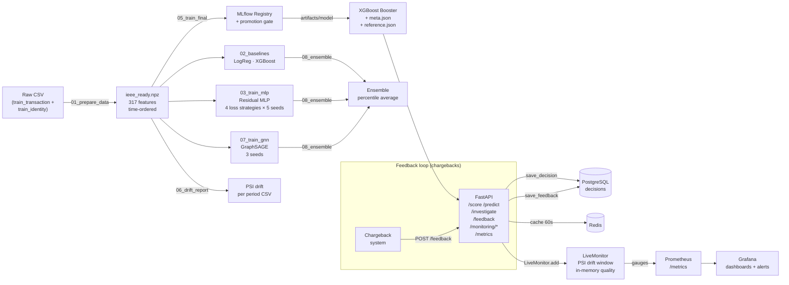

# FinGuard v2 — Fraud Detection on IEEE-CIS

Real data: Kaggle IEEE-CIS (590 K transactions, 3.5% fraud).  
Time-split evaluation (70 / 15 / 15). **No accuracy; only PR-AUC, ROC-AUC, and business cost.**

---

## Architecture



---

## Results (from `results.txt`)

> Cost baseline (no model, all fraud passes): **\$469,608**  
> A false alarm costs \$5; thresholds chosen on **validation**, used once on **test**.

### Baselines

| Model | PR-AUC | ROC-AUC | Threshold | Recall | Saved % |
|---|---|---|---|---|---|
| LogReg | 0.441 | 0.868 | cost-opt | 0.792 | **59.6%** |
| XGBoost | 0.574 | 0.905 | cost-opt | 0.821 | **62.8%** |
| XGBoost | 0.574 | 0.905 | P50 | 0.625 | 51.6% |

### MLP (5 seeds, best strategy per threshold type)

| Strategy | PR-AUC | Threshold | Recall | Saved % |
|---|---|---|---|---|
| MLP + BCE | 0.483 ± 0.008 | cost-opt | 0.768 | 60.9% |
| MLP + focal | 0.486 ± 0.009 | P50 | 0.540 | 41.7% |
| MLP + BCE + oversample | 0.486 ± 0.006 | P50 | 0.537 | 44.8% |

### GNN — GraphSAGE (3 seeds)

| Model | PR-AUC | ROC-AUC | Recall | Saved % |
|---|---|---|---|---|
| GNN @cost-thr | 0.469 ± 0.006 | 0.861 ± 0.011 | 0.752 | 59.3% |
| GNN @P50-thr | 0.469 ± 0.006 | 0.861 ± 0.011 | 0.519 | 40.9% |

### Drift Report (4 test periods)

| Period | PR-AUC | Score PSI | Big-shift features |
|---|---|---|---|
| Validation (baseline) | 0.6535 | 0.0006 ✅ | 21 |
| Test period 1 | 0.6108 | 0.0041 ✅ | 34 |
| Test period 2 | 0.5262 | 0.0038 ✅ | 11 |
| Test period 3 | 0.5588 | 0.0028 ✅ | 19 |
| Test period 4 | 0.5983 | 0.0025 ✅ | 37 |

Score PSI is stable across all periods. Feature drift is real but manageable (mostly history features that grow with time).

**Winner: XGBoost @cost-thr** — highest PR-AUC (0.574), saves **62.8%** of fraud losses.

---

## Setup

```bash
# 1. Put train_transaction.csv and train_identity.csv in data/
# 2. Install dependencies
pip install -r requirements.txt
# GPU (NVIDIA CUDA 12.1):
pip install torch --index-url https://download.pytorch.org/whl/cu121
```

## Pipeline

```bash
# Part 1 – features & model comparison
python scripts/01_prepare_data.py     # → data/ieee_ready.npz
python scripts/02_baselines.py        # LogReg + XGBoost (3 seeds)
python scripts/03_train_mlp.py        # MLP × 4 strategies × 5 seeds
python scripts/04_ablation.py         # feature-group ablation
python scripts/07_train_gnn.py        # GraphSAGE GNN (3 seeds)
python scripts/08_ensemble.py         # all model combinations

# Part 2 – production
python scripts/05_train_final.py      # train → MLflow → artifacts/model
python scripts/06_drift_report.py     # PSI drift over 4 periods

# API (local)
uvicorn --app-dir src finguard.api:app --reload
# or full stack (API + PostgreSQL + Redis + MLflow UI)
docker compose up --build
```

Quick smoke-test: append `data 1` (1 seed) or `data 1 smoke` to any script.

## API Endpoints

| Method | Path | What it does |
|---|---|---|
| GET | `/health` | model version, store size, Redis status |
| GET | `/score/{txn_id}` | score a stored transaction (cached in Redis) |
| POST | `/predict` | score a raw feature dict (not persisted) |
| GET | `/decisions/{txn_id}` | retrieve a saved decision + SHAP factors |
| POST | `/investigate` | NL answer: "Why was #3487632 flagged?" |
| POST | `/feedback` | record real outcome `{txn_id, is_fraud}` for precision/recall tracking |
| GET | `/monitoring/summary` | last 1000 decisions, mean score (60 s Redis cache) |
| GET | `/monitoring/drift` | live PSI drift window (updates every 100 scored txns) |
| GET | `/monitoring/performance` | live precision / recall from confirmed feedback |
| GET | `/metrics` | Prometheus scrape endpoint |

Decisions: `APPROVE` · `FRAUD_REVIEW` (≥ cost-optimal threshold) · `FRAUD_BLOCK` (≥ 80% precision threshold, chosen on validation).

Explanations use **TreeSHAP** (built into XGBoost). Set `GROQ_API_KEY` for a natural-language gloss; without it a template is used.

```bash
curl localhost:8000/score/3487632          # score from feature store (cached)
curl -X POST localhost:8000/predict \
     -H "Content-Type: application/json" \
     -d '{"features": {"TransactionAmt": 1.5, "C1": 0.0}}'
curl -X POST localhost:8000/investigate \
     -H "Content-Type: application/json" \
     -d '{"question": "Why was transaction 3487632 flagged?"}'
# Record real outcome (chargeback confirmed as fraud → feeds live precision/recall)
curl -X POST localhost:8000/feedback \
     -H "Content-Type: application/json" \
     -d '{"txn_id": 3487632, "is_fraud": true}'
curl localhost:8000/monitoring/summary       # decision counts + mean score (60 s cache)
curl localhost:8000/monitoring/drift         # live PSI drift (updates every 100 txns)
curl localhost:8000/monitoring/performance   # live precision / recall from feedback
curl localhost:8000/metrics                  # Prometheus scrape endpoint
```

## How it avoids data leakage

- Split by **time** (never random).
- Every feature uses **only past rows**. Encoders/scalers fit on train only.
- Thresholds chosen on **validation**, applied once on **test**.
- Rolling aggregates and counts use a strict "past rows only" window.
- The GNN only connects each node to **earlier** neighbours.
- Covered by `tests/test_no_leakage.py`.

## Known limitations

- API reads features from a file (replay mode). Production needs a live feature store.
- History features grow over time → large feature PSI early in deployment (expected, documented).
- Docker setup was not tested on the author's machine — verify `docker compose up` on yours.

## Docs

- `docs/data_dictionary.md` — feature descriptions  
- `docs/ROADMAP.md` — planned improvements
