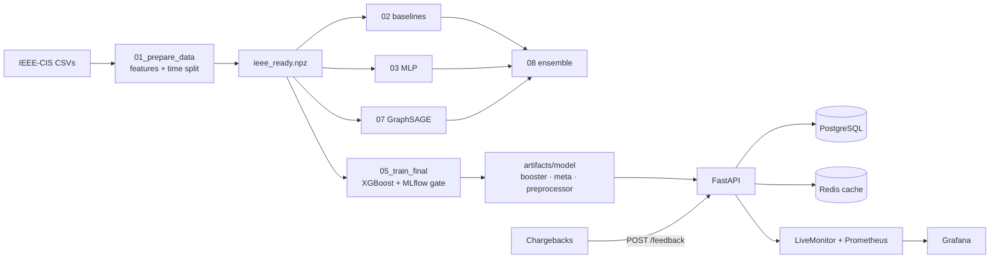

# FinGuard

Card-fraud detection on the [IEEE-CIS](https://www.kaggle.com/c/ieee-fraud-detection) dataset (590k transactions, ~3.5% fraud). The system ranks each payment with a fraud probability, then applies two validation-chosen thresholds:

| Decision | When |
|---|---|
| `APPROVE` | score below the cost-optimal review threshold |
| `FRAUD_REVIEW` | score high enough that sending it to an analyst is cheaper than missing fraud |
| `FRAUD_BLOCK` | score at a high-precision (≈80%) block threshold |

Metrics are **PR-AUC, ROC-AUC, and estimated dollar cost** — not accuracy.

---

## What the system does

1. **Offline** — build leak-free features, compare models, train a production XGBoost bundle.
2. **Online** — score stored or raw transactions, explain the score (TreeSHAP + optional LLM), record chargeback feedback, and watch drift / quality.

---

## Architecture



**Training path**

| Piece | Role |
|---|---|
| `finguard.ieee` | Load CSVs, past-only history/velocity features, time split, `Preprocessor` |
| `scripts/02–04, 07–08` | LogReg / XGBoost / MLP / ablation / GraphSAGE / ensemble comparison |
| `scripts/05_train_final.py` | Fit production XGBoost, pick REVIEW/BLOCK thresholds on **validation**, register in MLflow, promote only if test PR-AUC does not regress |
| `scripts/06_drift_report.py` | PSI of scores and features over successive test periods |

**Serving path**

| Module | Responsibility |
|---|---|
| `serving` | Load booster + thresholds; `FeatureStore` replay of prepared vectors |
| `raw_features` / `raw_score` | Turn a raw IEEE-CIS JSON row into a model vector (cold-start history) |
| `scoring` | Predict, decide, persist, cache |
| `runtime` | Process state (model, DB, Redis, monitor) and hot-reload |
| `api` | HTTP routes and dashboard (`/ui`) |
| `assistant` | “Why was #id flagged?” — facts from the model, wording from Groq or a template |
| `monitor` / `drift` | Rolling PSI, decision mix, live precision/recall |
| `db` | Decisions + feedback (SQLite locally, Postgres in Docker) |

---

## Results (from `results.txt`)

Cost baseline (no model): **$469,608**. A false alarm is counted as $5. Thresholds are chosen on validation and applied **once** on test.

| Model | PR-AUC | ROC-AUC | Recall | Saved % |
|---|---|---|---|---|
| LogReg | 0.441 | 0.868 | 0.792 | 59.6% |
| **XGBoost @ cost threshold** | **0.574** | **0.905** | **0.821** | **62.8%** |
| MLP (best) | 0.486 | — | 0.768 | 60.9% |
| GraphSAGE | 0.469 | 0.861 | 0.752 | 59.3% |

Score PSI stays low across four test periods; feature PSI is larger on history columns that grow with time (expected).

---

## Setup

```bash
# 1. Put train_transaction.csv and train_identity.csv in data/
pip install -r requirements.txt
# GPU (optional, NVIDIA CUDA 12.1):
pip install torch --index-url https://download.pytorch.org/whl/cu121
```

---

## Pipeline

```bash
python scripts/01_prepare_data.py     # → data/ieee_ready.npz
python scripts/02_baselines.py
python scripts/03_train_mlp.py
python scripts/04_ablation.py
python scripts/07_train_gnn.py
python scripts/08_ensemble.py

python scripts/05_train_final.py      # → artifacts/model (+ MLflow)
python scripts/06_drift_report.py
```

Append `data 1` (1 seed) or `data 1 smoke` / `data quick` on the relevant scripts for a short run.

---

## Demonstrate the model (no API)

Scores the time-split **test** set and prints labeled examples at every operating point: caught fraud (block / review), missed fraud, typical legit, and false alarms.

```bash
python scripts/10_evaluate_demo.py
```

Requires `data/ieee_ready.npz` and `artifacts/model`. Replay any printed `txn_id` with `/score/{id}` once the API is up.

---

## Run the API

```bash
uvicorn --app-dir src finguard.api:app --reload
# or: docker compose up --build
```

Dashboard: http://localhost:8000/ui · OpenAPI: http://localhost:8000/docs  
Compose also starts Postgres, Redis, MLflow (`:5000`), Prometheus (`:9090`), Grafana (`:3000`, admin/admin).

| Method | Path | Purpose |
|---|---|---|
| GET | `/health` | Model version, store size, Redis |
| GET | `/score/{txn_id}` | Score a stored (or previously raw-scored) id |
| POST | `/predict` | Score a **preprocessed** feature dict (not persisted) |
| POST | `/predict/raw` | Score a **raw IEEE-CIS** row; uses the store when the id is known |
| GET | `/decision/{txn_id}` | Saved decision + SHAP factors (`/decisions/...` also works) |
| POST | `/investigate` | Natural-language explanation |
| POST | `/feedback` | Real outcome `{txn_id, is_fraud}` |
| GET | `/monitoring/summary` | Recent decision mix |
| GET | `/monitoring/drift` | Live PSI window |
| GET | `/monitoring/performance` | Precision / recall from feedback |
| GET | `/metrics` | Prometheus |
| POST | `/admin/reload` | Hot-swap `MODEL_DIR` (see `docs/zero_downtime_upgrade.md`) |

```bash
curl localhost:8000/score/3487632
curl -X POST localhost:8000/predict/raw -H "Content-Type: application/json" \
     -d '{"TransactionID": 3487632, "TransactionAmt": 50.0, "ProductCD": "W"}'
curl -X POST localhost:8000/investigate -H "Content-Type: application/json" \
     -d '{"question": "Why was transaction 3487632 flagged?"}'
```

Set `GROQ_API_KEY` for LLM glosses; otherwise a template is used. `/predict/raw` without a store hit **cold-starts** history features (first-time client). Use `/score/{id}` for the full offline vector.

---

## Leakage controls

- Split by **time**, never at random.
- History, rolling counts, and GNN edges use **only earlier rows**.
- Encoders and scalers fit on **train** only.
- Thresholds chosen on **validation**, applied once on **test**.
- Covered by `tests/test_no_leakage.py` and `tests/test_pipeline_regression.py`.

---

## Limitations

- The feature store is a prepared file (replay). Live traffic needs an upstream store for velocity features.
- History features grow over time, so early feature PSI can be large even when score PSI is stable.
- Confirm `docker compose up` in your environment.

---

## Docs

- `docs/data_dictionary.md` — feature descriptions
- `docs/MONITORING.md` — Prometheus / Grafana
- `docs/zero_downtime_upgrade.md` — model swap
- `docs/ROADMAP.md` — planned work
