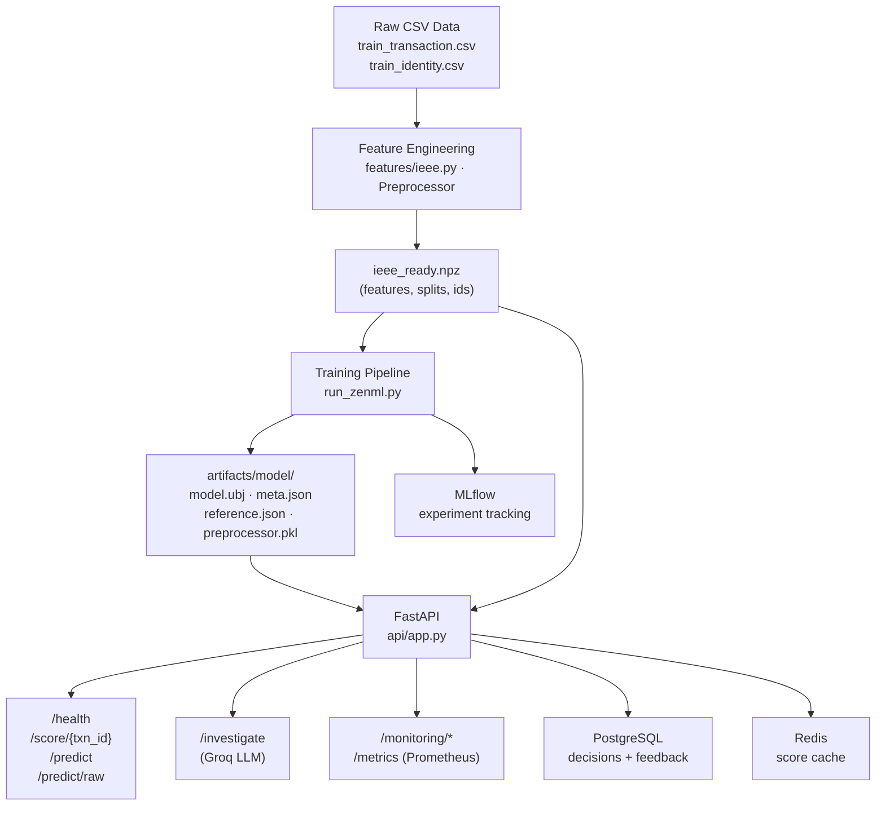

# FinGuard v2 — Production AI Fraud Detection Platform

[](https://www.python.org/downloads/)
[](https://fastapi.tiangolo.com)
[](https://xgboost.readthedocs.io/)
[](https://pytorch.org/)
[](https://mlflow.org/)
[](https://zenml.io)
[](https://opensource.org/licenses/MIT)

> Real-time payment fraud detection built on the IEEE-CIS dataset (590 k+ transactions). XGBoost production model scores transactions in **< 35 ms**, cuts net fraud loss by **62.8 %** (\$294 k saved on the out-of-time test set), and ships with a full observability stack (Prometheus + Grafana), zero-downtime hot-reload, and a natural-language investigation assistant powered by Groq.

---

## Architecture



---

## Key Results

| Model | Threshold | PR-AUC | Recall | Cost Saved |
|:---|:---|:---:|:---:|:---:|
| LogReg | @cost | 0.441 | 79.2% | 59.6% |
| MLP + weighted BCE | @cost | 0.475 | 78.1% | 63.3% |
| GNN (GraphSAGE) | @cost | 0.469 | 75.2% | 59.3% |
| **XGBoost (production)** | **@cost** | **0.574** | **82.1%** | **62.8%** |

*Unmitigated baseline cost (no model): \$469,608. XGBoost saves \$294,735 on the held-out test set.*

---

## Repository Layout

```
finguard2/
├── api/                    # FastAPI application
│   ├── app.py              # Routes: /health, /score, /predict, /investigate, /monitoring
│   ├── runtime.py          # Process state, model/store/DB lifecycle
│   ├── schemas.py          # Pydantic request bodies
│   ├── scoring.py          # Score, persist, cache a transaction
│   ├── serving.py          # Model loader + FeatureStore (NPZ replay)
│   ├── raw_features.py     # Cold-start preprocessing for /predict/raw
│   └── raw_score.py        # /predict/raw orchestration + quality notes
│
├── features/
│   └── ieee.py             # Leak-free feature engineering + Preprocessor
│
├── models/                 # PyTorch research models (MLP + GNN)
│   ├── mlp.py              # ResNet-MLP with residual blocks
│   ├── gnn.py              # GraphSAGE multi-relational GNN
│   ├── losses.py           # FocalLoss + class-weighted BCE
│   ├── trainer.py          # Training loop with early stopping
│   └── torch_data.py       # DataLoaders and datasets
│
├── pipelines/              # ZenML MLOps pipeline
│   ├── training_pipeline.py
│   └── steps/
│       ├── prepare_data_step.py    # Load CSVs → feature engineering → NPZ
│       ├── train_model_step.py     # XGBoost training with early stopping
│       ├── evaluate_step.py        # Threshold calibration + test metrics
│       └── register_model_step.py  # Bundle export, MLflow logging, promotion
│
├── monitoring/             # Observability stack
│   ├── drift.py            # Population Stability Index (PSI)
│   ├── monitor.py          # LiveMonitor (rolling window + Prometheus gauges)
│   ├── prometheus.yml      # Scrape config
│   ├── alerts.yml          # Alertmanager rules
│   └── grafana/            # Grafana dashboard provisioning
│
├── database/
│   └── db.py               # SQLAlchemy (SQLite/PostgreSQL) + Redis cache
│
├── assistant/
│   ├── assistant.py        # Groq LLM + template fallback
│   └── explain.py          # Feature name → human-readable description
│
├── evaluation/
│   ├── metrics.py          # Cost threshold, PR-AUC, ROC-AUC, report()
│   └── evaluation.py       # ShowcaseRow, batch decisions, summary counts
│
├── scripts/                # Standalone training runners (01–10)
│   ├── 01_prepare_data.py
│   ├── 02_baselines.py
│   ├── 03_train_mlp.py
│   ├── 04_ablation.py
│   ├── 05_train_final.py   # Produces artifacts/model/ (the production bundle)
│   ├── 06_drift_report.py
│   ├── 07_train_gnn.py
│   ├── 08_ensemble.py
│   ├── 09_simulate_traffic.py
│   └── 10_evaluate_demo.py
│
├── tests/                  # 13 modular test suites
├── data/                   # Raw CSVs (gitignored) + sample JSON rows
├── artifacts/              # Model bundles (gitignored except .gitkeep)
├── docs/                   # Data dictionary, monitoring guide, roadmap
│
├── Dockerfile              # Production serving image (CPU-only)
├── docker-compose.yml      # API + PostgreSQL + Redis + MLflow + Prometheus + Grafana
├── requirements.txt        # Full development environment
├── requirements-serving.txt# Minimal serving image dependencies
├── requirements-test.txt   # CI test suite dependencies
├── run_zenml.py            # ZenML pipeline entrypoint
└── .env.example            # Environment variable reference
```

---

## Quickstart

### 1. Install dependencies

```bash
git clone https://github.com/yourusername/finguard.git
cd finguard

python -m venv .venv
# Linux / macOS:
source .venv/bin/activate
# Windows:
.venv\Scripts\activate

pip install -r requirements.txt
```

> **GPU (NVIDIA CUDA 12.1):** `pip install torch --index-url https://download.pytorch.org/whl/cu121`

### 2. Prepare your data

Place the Kaggle IEEE-CIS files in `data/`:
```
data/
├── train_transaction.csv
├── train_identity.csv
```

### 3. Train the model

**Option A — ZenML pipeline (recommended)**
```bash
python run_zenml.py            # full training (~30 min on CPU)
python run_zenml.py --quick    # smoke test with 50 trees
```

**Option B — Step-by-step scripts**
```bash
python scripts/01_prepare_data.py
python scripts/05_train_final.py   # produces artifacts/model/
```

### 4. Start the API locally

```bash
uvicorn api.app:app --reload
```

API is live at `http://localhost:8000`. Swagger docs at `http://localhost:8000/docs`.

### 5. Full-stack deployment (Docker Compose)

```bash
cp .env.example .env          # fill in GROQ_API_KEY and other secrets
docker compose up --build -d
```

| Service | URL |
|:---|:---|
| API + Swagger | `http://localhost:8000/docs` |
| MLflow UI | `http://localhost:5000` |
| Prometheus | `http://localhost:9090` |
| Grafana | `http://localhost:3000` (admin / admin) |

---

## API Reference

| Method | Endpoint | Description |
|:---|:---|:---|
| `GET` | `/health` | Model version, store size, Redis status |
| `GET` | `/score/{txn_id}` | Score a pre-computed transaction (Redis-cached, logged to DB) |
| `POST` | `/predict` | Score a pre-scaled feature vector (ephemeral) |
| `POST` | `/predict/raw` | Score a raw IEEE-CIS JSON payload (auto-preprocessing) |
| `GET` | `/decisions/{txn_id}` | Retrieve a stored decision + SHAP factors |
| `POST` | `/investigate` | Natural-language fraud explanation (Groq Qwen3-27B) |
| `POST` | `/feedback` | Record confirmed fraud/legitimate outcome |
| `GET` | `/monitoring/summary` | Last 1 000 decisions vs. training baseline |
| `GET` | `/monitoring/drift` | Live PSI drift report |
| `GET` | `/monitoring/performance` | Live precision/recall from feedback |
| `GET` | `/metrics` | Prometheus metrics endpoint |
| `POST` | `/admin/reload` | Zero-downtime hot-swap of the production model |

### Example: score a transaction

```bash
curl http://localhost:8000/score/2987045
```
```json
{
  "txn_id": 2987045,
  "fraud_prob": 0.0021,
  "decision": "APPROVE",
  "model_version": "20261112-1430-a3f1b2",
  "factors": [],
  "from_cache": false
}
```

### Example: natural-language investigation

```bash
curl -X POST http://localhost:8000/investigate \
  -H "Content-Type: application/json" \
  -d '{"question": "Why was transaction 3487632 flagged?"}'
```
```json
{
  "txn_id": 3487632,
  "answer": "Transaction #3487632 was flagged as high risk.\n\nThe model flagged it due to an extreme spike in recent transaction frequency (C5 = 12), an unusually high Vesta risk signal (V264), and an uncommon card profile. This is a model signal, not proof of fraud.\n\nRisk Score: 0.84\nDecision: FRAUD_BLOCK"
}
```

---

## Running Tests

```bash
# Fast core tests (no model artifacts needed)
pytest tests/ -v --tb=short

# Individual suites
pytest tests/test_leakage_temporal.py    # no future data in features
pytest tests/test_drift_psi.py           # PSI calculations
pytest tests/test_database_cache.py      # DB + Redis
pytest tests/test_api_endpoints.py       # requires artifacts/model/
```

| Test suite | What it checks |
|:---|:---|
| `test_leakage_temporal` | Rolling counts never peek at future rows |
| `test_leakage_features` | `isFraud` / `TransactionID` never leak into feature matrices |
| `test_feature_alignment` | Feature count, names, and order are consistent |
| `test_missing_handling` | Graceful NaN handling and missing-indicator columns |
| `test_categorical_encoding` | Frequency mapping and unseen-category handling |
| `test_thresholds_cost` | Cost-threshold, precision-threshold, and F1 calculations |
| `test_drift_psi` | Population Stability Index baseline comparisons |
| `test_database_cache` | SQLite/PostgreSQL persistence + Redis graceful fallback |
| `test_models_neural` | Tensor shapes for ResNet-MLP and GraphSAGE GNN |
| `test_assistant_llm` | Regex parsing of transaction IDs in natural-language queries |
| `test_monitor_feedback` | LiveMonitor sliding window + Prometheus gauge hooks |
| `test_api_endpoints` | Prediction range, non-trivial fraud rates, model loading |
| `test_evaluation` | Confusion matrix and showcase-example generation |

---

## Feature Engineering Highlights

The 319 engineered features fall into three families that drive the model:

1. **Transaction velocity counters** (`C5`, `C8`, `C14`, `C4`, `C3`, `C11`) — how many transactions the card/client made recently.
2. **Vesta interaction vectors** (`V264`, `V70`, `V91`, `V142`, `V30`, `V189`, `V283`) — Vesta's proprietary risk signals.
3. **Co-missing pattern flags** (`M4_na`, `Vblock_V75_na`) — block-structured missingness reveals device/card fingerprints.

All features are computed using **only past rows** (rolling windows, cumulative sums), so there is zero temporal data leakage.

**Ablation result:** removing engineered features and using only raw inputs drops PR-AUC from 0.549 → 0.162 (−70%).

---

## Monitoring & Drift Detection

The `/monitoring/*` endpoints and the Grafana dashboard track:

- **Score drift** — PSI of the live fraud probability distribution vs. the training reference.
- **Feature drift** — per-feature PSI; alert fires when > 40 features shift significantly.
- **Flagged share** — alert fires when live flag rate is 2× or 0.25× the training baseline.
- **Live precision/recall** — computed from `/feedback` outcomes; alert fires when precision drops below 60% of test-set precision.

Prometheus scrapes `/metrics` every 10 s. All gauges and alerts are defined in `monitoring/prometheus.yml` and `monitoring/alerts.yml`.

---

## Zero-Downtime Model Reload

```bash
# Deploy a new model bundle to artifacts/model/, then:
curl -X POST http://localhost:8000/admin/reload
```

The reload is protected by a threading lock — only one reload runs at a time, and in-flight `/score` requests finish with the old model.

---

## Configuration

All settings are controlled by environment variables (copy `.env.example` → `.env`):

| Variable | Default | Description |
|:---|:---|:---|
| `MODEL_DIR` | `artifacts/model` | Path to the production model bundle |
| `FEATURE_FILE` | `data/ieee_ready.npz` | Path to the prepared feature store |
| `DATABASE_URL` | `sqlite:///finguard.db` | SQLAlchemy connection string |
| `REDIS_URL` | *(unset)* | Redis URL — cache disabled when absent |
| `GROQ_API_KEY` | *(unset)* | Groq API key — template used when absent |
| `LLM_MODEL` | `qwen/qwen3-27b` | Groq model for `/investigate` |
| `CORS_ORIGINS` | `*` | Comma-separated allowed origins (restrict in production) |
| `MLFLOW_TRACKING_URI` | `mlflow.db` | MLflow tracking URI |
| `GRAFANA_PASSWORD` | `admin` | Grafana admin password (docker compose) |

---

## License

MIT License — see [LICENSE](LICENSE).
