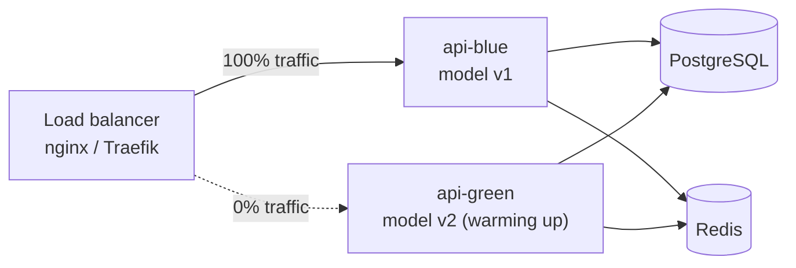
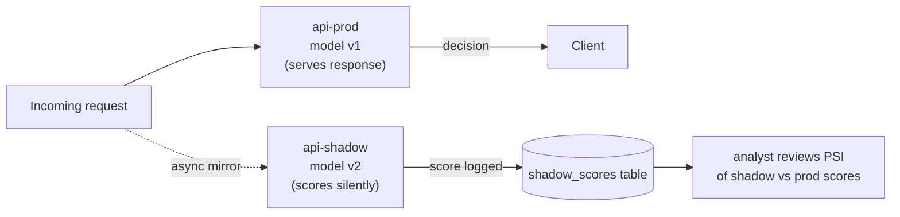

# Zero-Downtime Model Upgrades — FinGuard v2

> **Goal:** replace the XGBoost model (and optionally `reference.json`) while the API
> serves live traffic, with no dropped requests and no window where scores come from
> two different model versions simultaneously.

---

## Overview

FinGuard loads the model **once at startup** from `MODEL_DIR` (default `artifacts/model`).
A "model upgrade" means putting a new model directory in place and signalling the API to
switch to it — without restarting the Python process (hot reload) **or** by using a
blue/green container swap (zero-downtime restart).

Pick the strategy that matches your infrastructure:

| Strategy | Downtime | Complexity | Best for |
|---|---|---|---|
| [Hot reload (atomic swap)](#1-hot-reload-atomic-directory-swap) | **0 ms** | low | single container / bare metal |
| [Blue/green containers](#2-bluegreen-container-swap) | **0 ms** | medium | Docker Compose / Swarm |
| [Canary (shadow scoring)](#3-canary-shadow-scoring) | **0 ms** | high | production with safety gates |

---

## 1. Hot Reload — Atomic Directory Swap

The API exposes a `POST /admin/reload` endpoint (add it once, described below).
The pattern:

```
artifacts/model/           ← symlink → artifacts/model_v2/   (active)
artifacts/model_v1/        ← previous version (keep for rollback)
artifacts/model_v2/        ← new version (staged)
```

### Step-by-step

```bash
# 1. Train and register the new model (outputs artifacts/model_v2/)
python scripts/05_train_final.py --run-name v2

# 2. Verify the new model passes the promotion gate
#    (05_train_final.py already does this via MLflow — PR-AUC must beat the champion)

# 3. Atomic symlink swap — Linux/Mac:
ln -sfn $(pwd)/artifacts/model_v2 artifacts/model

# Windows (run as Admin or use mklink):
# Remove-Item artifacts\model -Force
# cmd /c mklink /D artifacts\model artifacts\model_v2

# 4. Signal the running API to reload (no restart):
curl -X POST http://localhost:8000/admin/reload
# → {"reloaded": true, "model_version": "v2", "features": 317}

# 5. Confirm
curl http://localhost:8000/health | python -m json.tool
```

### Add the `/admin/reload` endpoint to `api.py`

```python
# Add to api.py (after the /metrics endpoint)
import threading
_reload_lock = threading.Lock()

@app.post("/admin/reload", include_in_schema=False)
def admin_reload(request: Request):
    """Hot-reload the model from MODEL_DIR without restarting the process.

    Atomic: a lock ensures only one reload runs at a time.
    In-flight /score requests finish with the OLD model; new requests
    get the NEW model immediately after the swap.
    """
    if not _reload_lock.acquire(blocking=False):
        raise HTTPException(503, "Reload already in progress")
    try:
        model_dir = os.getenv("MODEL_DIR", "artifacts/model")
        new_model  = Model(model_dir)
        new_monitor = LiveMonitor(
            model_dir=model_dir,
            feature_names=new_model.feature_names,
            review_thr=new_model.review_thr,
        )
        # Atomic swap — a single assignment is atomic in CPython
        state["model"]   = new_model
        state["monitor"] = new_monitor
        set_baselines(new_model.meta)
        log.info("Hot-reloaded model %s", new_model.version)
        return {
            "reloaded":      True,
            "model_version": new_model.version,
            "features":      len(new_model.feature_names),
        }
    finally:
        _reload_lock.release()
```

> [!IMPORTANT]
> Protect `/admin/reload` in production. Add an `Authorization: Bearer <RELOAD_SECRET>` check
> or firewall it to internal networks only. Never expose it to the public internet.

### Rollback

```bash
# Point symlink back at the previous version
ln -sfn $(pwd)/artifacts/model_v1 artifacts/model
curl -X POST http://localhost:8000/admin/reload
```

---

## 2. Blue/Green Container Swap

Run **two API containers** (`api-blue` and `api-green`) behind a load balancer (Nginx or
Traefik). One is live; the other warms up with the new model.



### Docker Compose blue/green setup

```yaml
# docker-compose.bluegreen.yml  (extend your base compose file)
services:
  api-blue:
    build: .
    environment:
      MODEL_DIR: /models/model_v1
    volumes:
      - ./artifacts/model_v1:/models/model_v1:ro
    # …same postgres/redis deps as base

  api-green:
    build: .
    environment:
      MODEL_DIR: /models/model_v2
    volumes:
      - ./artifacts/model_v2:/models/model_v2:ro

  nginx:
    image: nginx:alpine
    ports: ["8000:80"]
    volumes:
      - ./nginx/blue.conf:/etc/nginx/conf.d/default.conf:ro
    depends_on: [api-blue, api-green]
```

**`nginx/blue.conf`** — routes all traffic to blue:
```nginx
upstream finguard {
    server api-blue:8000;
    # server api-green:8000;   ← uncomment to switch to green
}
server {
    listen 80;
    location / { proxy_pass http://finguard; }
}
```

### Cutover procedure

```bash
# 1. Start green (blue still serving)
docker compose -f docker-compose.yml -f docker-compose.bluegreen.yml up -d api-green

# 2. Health-check green until ready
until curl -sf http://localhost:8001/health; do sleep 2; done

# 3. Switch nginx — zero dropped connections (nginx -s reload does graceful reload)
sed -i 's/# server api-green/server api-green/' nginx/blue.conf
docker compose exec nginx nginx -s reload

# 4. Watch error rate for 5 minutes (Grafana → finguard dashboard → HighErrorRate alert)

# 5. If OK: stop blue
docker compose stop api-blue

# Rollback: reverse step 3 and reload nginx
```

> [!TIP]
> `nginx -s reload` sends SIGQUIT to old workers — they finish in-flight requests (up to
> `worker_shutdown_timeout`) before exiting. No request is dropped.

---

## 3. Canary — Shadow Scoring

Send every request to **both** models simultaneously. Compare scores in the background.
Promote only when distributions match expectations.



### Nginx mirror config

```nginx
server {
    listen 80;
    location /score {
        proxy_pass http://api-prod:8000;
        mirror     /shadow;
    }
    location /shadow {
        internal;
        proxy_pass http://api-shadow:8000;
    }
}
```

The shadow response is discarded. Only the prod response reaches the client. No latency impact.

### Promotion gate

After N shadowed requests (suggested N ≥ 5000):

```bash
# Compare score distributions between prod and shadow
python scripts/compare_shadow.py \
  --prod-table decisions \
  --shadow-table shadow_scores \
  --min-rows 5000
# → prints PSI of shadow vs prod scores.
# Promote if PSI < 0.10 and shadow recall on labeled rows >= 0.9 × prod recall.
```

---

## 4. MLflow Promotion Gate (automated)

`05_train_final.py` already implements a gate: it refuses to register a new champion
unless PR-AUC on the validation set exceeds the current champion's PR-AUC.

Extend it for zero-downtime by adding an API-level gate:

```python
# In 05_train_final.py — after mlflow.register_model():
import requests, os

RELOAD_URL = os.getenv("API_RELOAD_URL", "http://localhost:8000/admin/reload")
SECRET     = os.getenv("RELOAD_SECRET", "")

r = requests.post(RELOAD_URL, headers={"Authorization": f"Bearer {SECRET}"}, timeout=10)
r.raise_for_status()
print("API hot-reloaded:", r.json())
```

Add `API_RELOAD_URL` and `RELOAD_SECRET` to your CI/CD secrets and your `docker-compose.yml`.

---

## 5. What to Check After Every Upgrade

Run this checklist immediately after the swap:

```bash
# 1. Health
curl http://localhost:8000/health

# 2. Version changed
curl http://localhost:8000/health | python -c "import sys,json; d=json.load(sys.stdin); print(d['model_version'])"

# 3. No error spike (Grafana HighErrorRate alert should stay green)

# 4. Score a known transaction and compare with pre-upgrade baseline
curl http://localhost:8000/score/3487632

# 5. Drift — scores should not spike (PSI < 0.10 expected right after upgrade
#    since the new model was trained on the same data)
curl http://localhost:8000/monitoring/drift | python -m json.tool

# 6. Clear Redis cache so old scores don't mask the new model's output
redis-cli FLUSHDB   # or: redis-cli --scan --pattern 'score:*' | xargs redis-cli DEL
```

> [!WARNING]
> **Clear the Redis cache after every model swap.** Otherwise `/score/{txn_id}` will return
> the old model's cached decision for up to 1 hour for already-scored transactions.

---

## 6. Schema Compatibility — What Must Stay the Same

| Artefact | Must be identical between versions | Why |
|---|---|---|
| `feature_names` (order + names) | ✅ Yes | The feature store serves a fixed 317-column vector |
| `review_thr`, `block_thr` | ❌ Can change | Re-read from `meta.json` on each reload |
| `reference.json` bins | ❌ Can change | LiveMonitor reads from the new model dir |
| DB schema (`Decision`, `Feedback`) | ✅ Yes | Rows written by old API must be readable by new |

If you need to **change the feature set** (e.g., add new columns), that is a breaking
upgrade — run a full pipeline rebuild (`01_prepare_data.py` → `05_train_final.py`) and
deploy with blue/green.

---

## 7. Rollback Decision Tree

```
After upgrade, within 10 minutes:
│
├── Error rate > 5%  (HighErrorRate alert fires)
│       └── IMMEDIATE rollback: repoint symlink, reload API, clear cache
│
├── PSI > 0.25  (ScoreDrift alert fires within 15 min)
│       └── INVESTIGATE: compare score histograms; rollback if unexplained
│
├── Live precision drops > 20% below baseline  (LivePrecisionDrop alert fires)
│       └── ROLLBACK and open incident
│
└── All clear for 1 hour
        └── Decommission old model dir (keep for 7 days as safety net)
```

---

## Quick Reference

```bash
# Hot-reload (single container)
ln -sfn $(pwd)/artifacts/model_v2 artifacts/model
curl -X POST http://localhost:8000/admin/reload

# Blue/green cutover
sed -i 's/# server api-green/server api-green/' nginx/blue.conf
docker compose exec nginx nginx -s reload

# Rollback (hot-reload)
ln -sfn $(pwd)/artifacts/model_v1 artifacts/model
curl -X POST http://localhost:8000/admin/reload

# Clear cache after any swap
redis-cli --scan --pattern 'score:*' | xargs redis-cli DEL
redis-cli DEL monitoring:summary
```
